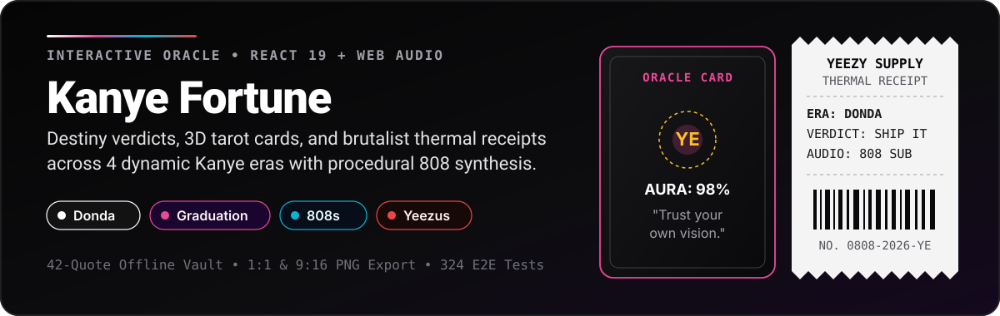
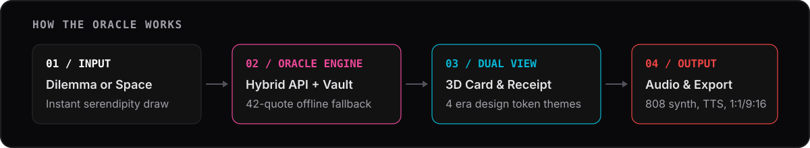

<p align="center">
  
</p>

<p align="center">
  <a href="https://react.dev/"></a>
  <a href="https://www.typescriptlang.org/"></a>
  <a href="https://vitejs.dev/"></a>
  <a href="https://tailwindcss.com/"></a>
  
</p>

**Kanye Fortune (Oracle of Ye)** is an interactive fortune-telling web application that pairs Kanye West era aesthetics with 3D tarot physics, brutalist thermal receipts, zero-asset Web Audio synthesis, and 1-click high-DPI social export.

---

## Quick Start

Requires **Node.js 20+**.

```bash
git clone https://github.com/ali0zdas/Kanye-Fortune.git
cd Kanye-Fortune
npm install
npm run dev
```

Press **`Space`** to draw your first fortune, **`V`** to switch between 3D Card and Thermal Receipt, or **`1`–`4`** to shift eras.

---

<p align="center">
  
</p>

## Core Capabilities

- **4 Dynamic Era Themes**: Switch between **Donda** (monolith void), **Graduation** (Murakami cosmic pop), **808s & Heartbreak** (neon synthwave), and **Yeezus** (industrial brutalism) — each with its own design tokens and audio profile.
- **Dual Presentation Views**:
  - **3D Tarot Card**: Interactive flip card with holographic borders, dynamic glow, and aura score.
  - **Yeezy Thermal Receipt**: Monochrome store receipt with serrated tear edges and barcode styling.
- **Procedural Web Audio & TTS**: Zero-asset audio synthesizer generating 808 sub-bass drops, vinyl crackle, printer clicks, and card whooshes, paired with Web Speech & remote TTS voicing.
- **High-DPI Social Export**: 1-click PNG export in **1:1 Square** and **9:16 Story** formats, plus direct clipboard and X (Twitter) sharing.
- **Offline Resilient**: Hybrid API connection with automatic fallback to a curated **42-quote offline vault**.

---

## Keyboard Shortcuts

| Key | Action |
| :--- | :--- |
| `Space` | Draw New Fortune |
| `F` | Flip 3D Card (Card Mode) |
| `V` | Toggle View Mode (Card / Receipt) |
| `M` | Toggle Audio Mute |
| `E` | Open Social Export Modal |
| `1` – `4` | Switch Era (`1` Donda, `2` Graduation, `3` 808s, `4` Yeezus) |

---

## Tech Stack

- **Core**: React 19, TypeScript, Vite 8
- **Styling & Motion**: Tailwind CSS v4, Framer Motion, Canvas Confetti, Lucide React
- **Export**: `html-to-image`

---

## Build & Verification

```bash
# Production build & local preview
npm run build
npm run preview

# Headless E2E test suite (324 tests across 4 tiers)
npm run test

# Full verification audits & adversarial stress tests
npm run test:all
```

---

## License

MIT
